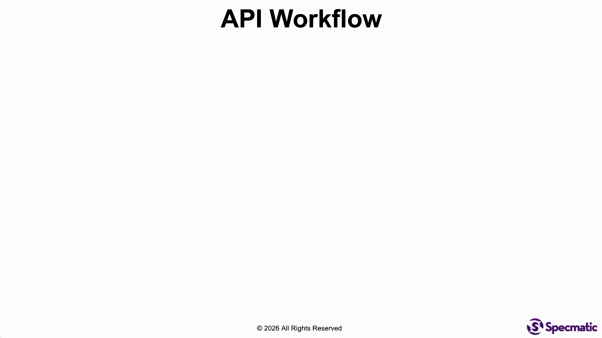

# Specmatic Arazzo Authentication Sample

This sample shows four FastAPI services with different authentication requirements, tested individually against their
OpenAPI contracts and together through a Specmatic Arazzo workflow. All four APIs also require mutual TLS (mTLS).




## Services

| API       | Local URL                                        | Operations                              | Application authentication                                                             |
|-----------|--------------------------------------------------|-----------------------------------------|----------------------------------------------------------------------------------------|
| Location  | [https://localhost:8001](https://localhost:8001) | `GET /location`                         | Static bearer token                                                                    |
| Products  | [https://localhost:8002](https://localhost:8002) | `GET /products`                         | OAuth password grant, `products:read`                                                  |
| Orders    | [https://localhost:8003](https://localhost:8003) | `POST /orders`, `GET /orders/{orderId}` | OAuth client credentials with `client_secret_basic`; `orders:create` and `orders:read` |
| Inventory | [https://localhost:8004](https://localhost:8004) | `PUT /inventory`                        | JWT bearer grant with `private_key_jwt`; `inventory:reserve`                           |

The OpenAPI contracts are in [`spec/openapi`](spec/openapi). Each API is an independent FastAPI application under [
`services`](services).

## PlaceOrder workflow

The Arazzo document at [`spec/arazzo/PlaceOrder.arazzo.yaml`](spec/arazzo/PlaceOrder.arazzo.yaml) calls the APIs in
sequence and passes values between steps:

1. `GET /location` looks up a user by email and returns `userId` and `locationCode`.
2. `GET /products` uses the location code and returns product details. If the result is empty, the workflow ends without creating an order.
3. `POST /orders` creates an order using the user, product, and inventory values, and returns an `orderId`.
4. `PUT /inventory` reserves inventory for that order.
5. `GET /orders/{orderId}` returns the final order details and status.

The example inputs are in [`spec/arazzo/PlaceOrder.arazzo_input.json`](spec/arazzo/PlaceOrder.arazzo_input.json). The
default input uses the Bengaluru user and runs the complete flow; a second input uses the Delhi user to demonstrate the
empty-products branch.

## Authentication

The application-level credentials and token flows differ by API:

- **Location:** the workflow reads a static bearer token from Commerce Vault.
- **Products:** Commerce Keycloak exchanges the sample username and password for a token with the `products:read` scope.
- **Orders:** Commerce Keycloak issues tokens through the client credentials grant. The client authenticates at the
  token endpoint with `client_secret_basic`; create and read operations use separate scopes.
- **Inventory:** Inventory Keycloak uses the JWT bearer grant. The client signs a grant assertion and authenticates
  separately with `private_key_jwt`, using keys stored in Identity Vault.

> Protected operations return `401 Unauthorized` for a missing or invalid token and `403 Forbidden` when a valid token
> lacks the required scope. The local Keycloak token endpoints use HTTP; API calls use HTTPS with mTLS.

The workflow runner configuration in [`tests/workflow/arazzo/specmatic.yaml`](tests/workflow/arazzo/specmatic.yaml)
defines Specmatic Vault profiles and binds the appropriate security profile to each Arazzo step. The service contract
suites have their own Specmatic configuration under `tests/contract/<service>`.

Supporting services used by the sample:

| Component          | Local URL                                      | Purpose                                            |
|--------------------|------------------------------------------------|----------------------------------------------------|
| Commerce Keycloak  | [http://localhost:9002](http://localhost:9002) | Issues Products and Orders tokens                  |
| Inventory Keycloak | [http://localhost:9001](http://localhost:9001) | Issues Inventory tokens                            |
| Commerce Vault     | [http://localhost:8200](http://localhost:8200) | Stores the Location token and Commerce credentials |
| Identity Vault     | [http://localhost:8201](http://localhost:8201) | Stores Inventory signing keys                      |
| PostgreSQL         | `localhost:5432`                               | Stores users, products, orders, and inventory      |

## HTTPS and mTLS

All four APIs serve HTTPS and require a client certificate signed by the sample CA. They share one server certificate
and key; clients use the separate shared client certificate and key. The `/healthz` endpoints also require mTLS.
Application bearer or OAuth authentication is still required for protected API operations after the TLS handshake
succeeds.

The demo fixtures are in [`certs`](certs). Check the health endpoint with `curl`:

```shell
curl --fail \
  --cacert certs/ca.crt \
  --cert certs/client.crt \
  --key certs/client.key \
  https://localhost:8001/healthz
```

Specmatic uses the client identity from `certs/specmatic-client.jks`. The same JKS is configured for the Arazzo workflow
and Studio.

These certificates and keys are demo-only material. Do not reuse them outside this sample. To generate a fresh set, run
`bash scripts/generate_demo_certs.sh`; this requires OpenSSL and Java `keytool` and replaces the certificate fixtures in
`certs`.

## Run the tests

Requirements:

- Docker Engine with Docker Compose
- Python 3.13
- [`uv`](https://docs.astral.sh/uv/)
- Docker access to `specmatic/enterprise:latest` for Specmatic runs

From the project directory, install the locked Python dependencies:

```shell
uv sync --locked
```

Run all Python auth checks, four provider contract suites, mTLS checks, and the Arazzo workflow:

```shell
uv run --locked pytest tests -v -s
```

Run an individual provider suite or the workflow:

```shell
uv run --locked pytest tests/contract/location -v -s
uv run --locked pytest tests/contract/products -v -s
uv run --locked pytest tests/contract/orders -v -s
uv run --locked pytest tests/contract/inventory -v -s
uv run --locked pytest tests/workflow/arazzo -v -s
```

Pytest starts the required Docker services and waits for their health checks. Specmatic runs in containers attached to
the Compose network. If pytest started the stack, it stops it when the test session ends. Test settings and default
endpoints are in [`.env.test`](.env.test); local overrides can go in `.env`.

## Test reports

Reports are written under `build/reports/specmatic/`:

- Arazzo workflow outputs: `build/reports/specmatic/arazzo/html/workflow_outputs.json`; the HTML report is
  `build/reports/specmatic/arazzo/html/index.html`.
- Each API contract suite writes an HTML report to `build/reports/specmatic/<service>/test/html/index.html` and a CTRF
  JSON report to `build/reports/specmatic/<service>/test/ctrf/ctrf-report.json`, where `<service>` is `location`,
  `products`, `orders`, or `inventory`.

## Run the sample in Specmatic Studio

Start the APIs, their dependencies, and Studio:

```shell
docker compose --profile studio up --build -d
```

Open [http://localhost:9000/_specmatic/studio](http://localhost:9000/_specmatic/studio) to access Studio. Stop the stack with:

```shell
docker compose --profile studio down -v --remove-orphans
```

## Project files

- `spec/openapi/` — the four OpenAPI contracts.
- `spec/arazzo/` — the Arazzo workflow and sample inputs.
- `tests/contract/` — per-service Specmatic suites and Python auth checks.
- `tests/workflow/arazzo/` — Specmatic configuration and test for the workflow.
- `scripts/` — database seeding, Keycloak and Vault setup, and demo certificate generation.
